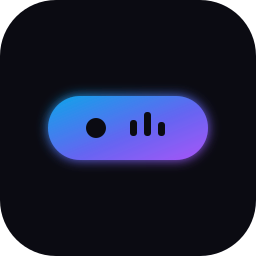
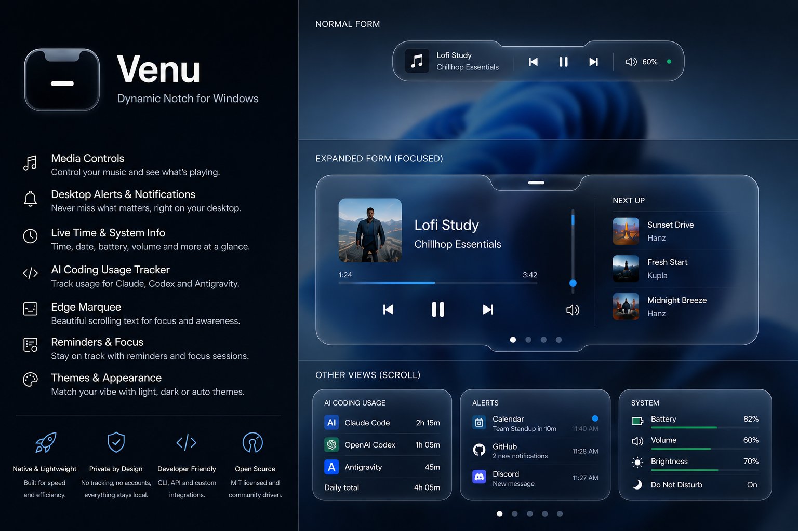
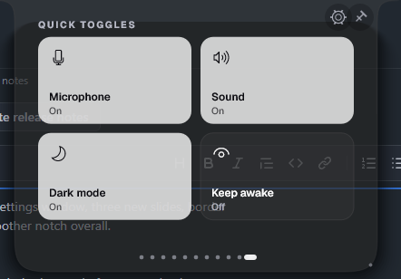
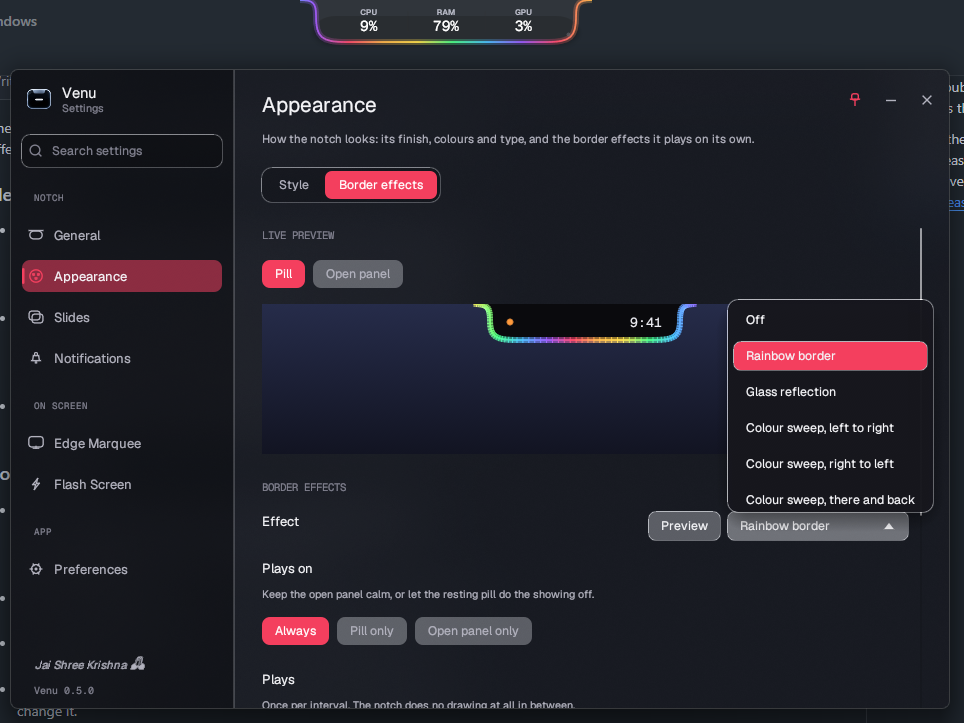
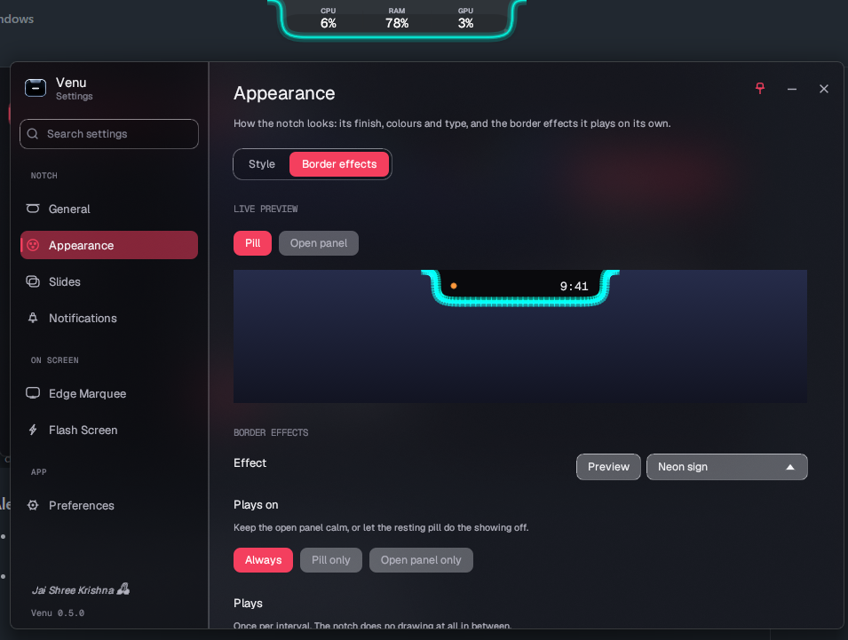
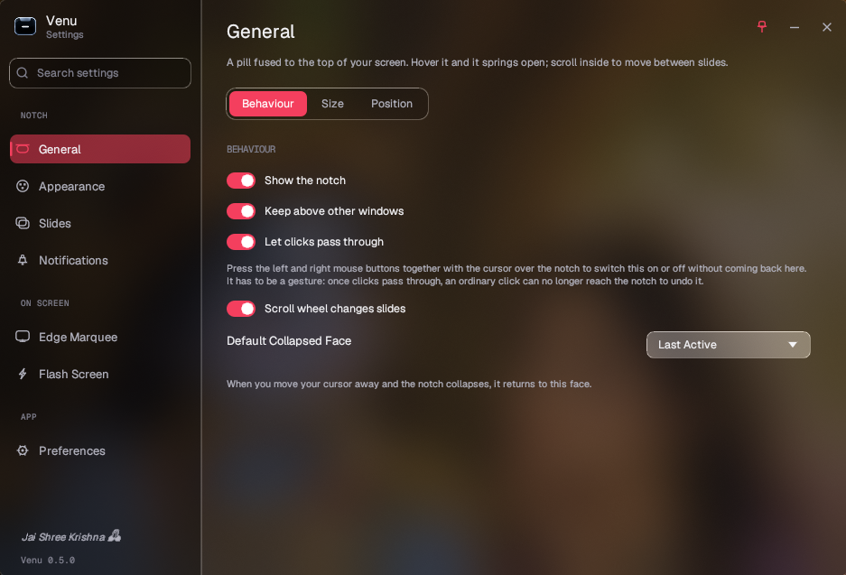
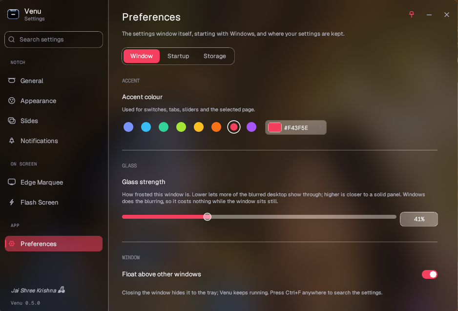
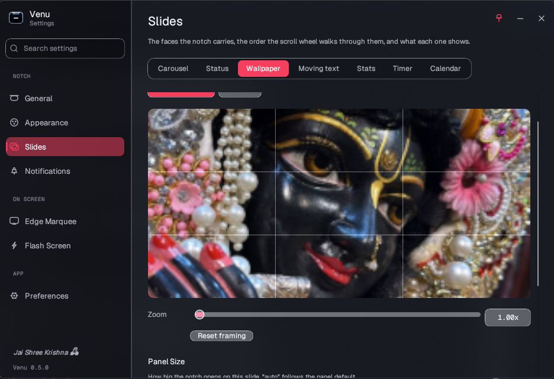

<p align="center">
  
</p>

<h1 align="center">HermesPill</h1>

<p align="center">
  <strong>Dynamic Notch for Windows</strong>
</p>

<p align="center">
  A native desktop companion for Windows 10 and Windows 11 that brings media controls, notifications, system information, reminders, and AI coding usage into a compact glass notch.
</p>

<p align="center">
  <a href="https://github.com/bangshogir/hermespill/releases"></a>
  <a href="https://github.com/bangshogir/hermespill/actions/workflows/ci.yml"></a>
  
  
  
</p>

<p align="center">
  
</p>

## What is HermesPill?

HermesPill is a **Dynamic Notch (Dynamic Island) for Windows**, purpose-built as a
**Mission Control surface for Hermes Agent** — the open-source agent from Nous Research.

It turns the strip at the top of your desktop into a live, always-visible HUD: watch your
agent work, see which tasks are running, get notified the moment something finishes or
fails, and keep an eye on usage and system state — without switching windows.

> **This project is a fork of [Venu — Dynamic Notch for Windows](https://github.com/imnakul/venu---Dynamic-Notch-for-Windows)
> by Nakul Srivastava (MIT).** All the notch, media, notification and rendering
> machinery is theirs; HermesPill adds the Hermes-focused direction and branding.
> See [Credits](#credits).

## Why HermesPill?

When you run agents in the background, you need to glance at what they are doing — not
alt-tab into a dashboard.

- **Agent-aware by design**: speaks the Hermes webhook protocol (local HTTP on `127.0.0.1:18923`).
- **Live activity pods**: a satellite pod counts up while an agent or task is running.
- **Instant completion alerts**: success / warning levels when a job ends.
- **Everything Venu gives you**: media controls, notifications, system stats, timers, calendar,
  clipboard history, edge marquee, glass themes — all local, no account, no cloud.

## AI Coding Usage Tracker

HermesPill can display AI coding tool usage directly inside the Windows Dynamic Notch.

Supported usage views include:

- **Claude Code**: context window, session cost, and rate limits
- **OpenAI Codex**: usage information directly in the notch
- **Google Antigravity**: usage information directly in the notch

This makes HermesPill especially useful for developers who spend most of their day working with AI coding agents. Instead of opening separate dashboards or repeatedly checking terminal output, important usage information can stay visible in the desktop HUD.

HermesPill also includes notification hooks for developer tools and AI agents such as Claude Code, Codex, and Antigravity, allowing scripts and development workflows to send events directly to the Dynamic Notch.

## Features

### Dynamic Notch / Desktop HUD

A compact Dynamic Island-style panel that expands when you need it and stays out of the way when you do not.

- Smooth spring-based expansion and collapse
- Open with a **click**, a **hover**, or either; hover waits a moment you choose and ignores the cursor sweeping past on its way to a tab
- No accidental opening while dragging a window or file, or over full-screen apps and games
- Close with **Esc**, a **click outside**, or **moving the cursor away** — any combination, all in Settings › Controls
- Right-click menu on the notch's own glass, with smooth open, close and hover, and arrow keys + Enter: Settings, keep open, pause hover, click-through, pages, quit. It works even while clicks pass through
- Never stuck: **Reset controls** and a click-through switch in the tray menu and at the top of Settings
- Music controls and the live wave right on the closed pill
- Hover highlights, a hand cursor and a soft ripple on everything clickable in the panel
- Pick a click gesture (Ctrl + click, middle click…) and only that opens the notch
- Global keyboard shortcuts you set yourself (default `Ctrl + Alt + N` to open or close, `Ctrl + Alt + C` for click-through)
- A mouse trigger over the notch: middle click, a side button, or Ctrl/Alt/Shift + click (works even with click-through on)
- Scroll to change pages on the open panel and, optionally, on the closed pill
- Top or bottom placement
- Configurable monitor, width, height, and offset
- Multiple information slides
- Mouse wheel navigation
- Pin mode for keeping the panel expanded
- Optional click-through mode
- Automatic mode that can prioritize active notifications, media, or the clock

Available slides include:

- **Status**: Focus and today's priorities
- **Clock**: Large digital clock and date
- **Media**: Current track, artist, artwork, and playback controls
- **Notifications**: Notification center and unread indicators
- **Wallpaper**: Image preview with optional caption
- **Marquee**: Moving reminder or custom text
- **AI Usage**: Claude, Codex, and Antigravity usage information
- **Stats**: whole-PC CPU and physical RAM, the busiest GPU engine, and battery or AC power
- **Focus Timer**: Pomodoro rounds and breaks, with the countdown in the resting pill
- **Calendar**: your next meeting and what follows, from a Google Calendar or Outlook iCal link
- **Quick Toggles**: mute the microphone or sound, switch dark mode, keep the PC awake
- **Shelf**: pinned files, folders, apps and `.bat` scripts, plus the newest files of a folder such as Screenshots; one click opens, right-click copies (HermesPill stores paths only, never copies)
- **Clipboard**: the last few things you copied, one click to copy again (opt-in, memory only, private content skipped)

<p align="center">
  
</p>

<p align="center">
  
  <br>
  
</p>
<p align="center"><sub>Focus Timer and Quick Toggles on the resting pill.</sub></p>

### Split Pill

Show more than one thing at a glance without a second notch. With **Settings > General > Layout > Split pill** on, the resting pill keeps its usual face in the middle and adds a fixed face on either side — for example the time on the left and CPU / RAM on the right.

- Any slide can be a side segment: Clock, Stats, Moving text, Timer, Calendar, Now Playing and more
- A side that matches the middle face hides itself, so nothing is ever shown twice
- Hover a side segment and the panel opens straight onto that slide; when it closes, the pill goes back to the face it was resting on

### Satellite Pods

Live activities bud out of the notch as small pods beside it, and merge back into it when you open the panel (**Settings > General > Layout > Satellite pods**).

- **Coding agents at work** — e.g. Claude Code, with how long it has been running (see below)
- **Focus timer** running, with its countdown ring
- **A meeting** happening now or starting soon
- **Music** that is playing
- At most two at once, in priority order; a pod never repeats a face already on the pill
- Hover a pod to open the notch onto its slide

### Notch Shape

**Settings > Appearance > Shape** controls the silhouette and finish, with a live preview:

- Style presets — **Classic**, **Pill**, **Soft**, **Sharp** — as starting points
- Corner roundness for the resting pill and the open panel
- Shoulder size: how the notch melts into the top edge (0 for square shoulders)
- Outline, glass sheen and shadow strength, relative to the chosen theme

### Border Effects

The notch can play an effect around its edge on an interval or continuously: Rainbow, Glass reflection, Colour sweeps, Breathing glow, Aurora, Comet, Neon sign, Heartbeat and Fire. Effects can play on the resting pill, the open panel, or both, and Settings shows a live preview. Nothing is drawn between runs.

<table>
  <tr>
    <td></td>
    <td></td>
  </tr>
  <tr>
    <td align="center"><sub>Rainbow border</sub></td>
    <td align="center"><sub>Neon sign</sub></td>
  </tr>
</table>

<p align="center">
  
  <br>
  <sub>Fire, on the resting pill.</sub>
</p>

### Media Controls

Control media playback without leaving your current application.

HermesPill integrates with Windows System Media Transport Controls to show the currently playing track, artist, artwork, playback state, and controls for play, pause, previous, and next.

- A centred player: the album cover or video thumbnail large in the middle, the title, artist or channel and the app under it, then the timeline and controls
- A live equaliser on the pill and the media pod that follows what is actually playing
- Click the media pod to play or pause, the timer pod to pause or resume

### Notifications

Turn the Dynamic Notch into a lightweight notification hub.

- Live desktop alerts
- Unread notification indicators
- Notification center
- Individual dismissal
- Clear all notifications
- Application-specific colors
- Custom animated notification glow styles
- Local webhook support for external tools and scripts
- Charging, unplugged and low-battery alerts
- **Microsoft Store version:** notifications from every Windows app, with your permission. Windows only lets packaged apps read the notification center, so the portable and installer builds show alerts from the webhook only. HermesPill keeps the latest four in memory for the session; nothing is written to disk.

### AI Agent and Developer Notifications

HermesPill can act as a small desktop HUD for your development workflow.

CLI hooks in `scripts/notch-hooks/` allow external tools, build scripts, AI agents, and development workflows to send instant notifications to HermesPill.

This can be useful for events such as:

- AI coding agent task completion
- Long-running build completion
- Test results
- Deployment status
- Background scripts finishing
- Agent attention or approval requests

Work in progress can also be shown as a satellite pod. Post to `/activity` when something starts, and HermesPill shows a pod counting up beside the notch:

```bash
curl -X POST http://127.0.0.1:18923/activity -H "Content-Type: application/json" \
  -d '{"app":"Claude","state":"start"}'
```

Post `"state":"stop"` when it ends — or just send a normal notification with `"level":"success"` from the same app, which closes it too. Anything not stopped is dropped after an hour. For Claude Code, register `scripts/notch-hooks/claude-activity.ps1` as a `UserPromptSubmit` hook; the existing Stop hook (`claude-notify.ps1`) already ends the pod.

### Edge Marquee

Display scrolling text around the edges of your Windows desktop.

- Top, bottom, left, and right edges
- Custom text and reminders
- Adjustable speed and direction
- Configurable thickness and spacing
- Custom colors and opacity
- Always-on-top support
- Click-through mode
- Unicode support including Latin, Devanagari, CJK, and symbols

Use it for reminders, quotes, status information, temporary notes, or anything you want to keep visible while working.

### Settings Window

A floating glass window that sits beside your work. Seven pages in three groups, each split into tabs, with a search box (Ctrl+F) that jumps straight to any setting.

- Frosted glass over your desktop, with a Glass strength slider
- Your own accent colour for switches, tabs, sliders and the selected page
- Sliders for every number, switches instead of checkboxes, gliding tabs
- A wallpaper picker that shows exactly how the notch will frame your image

<table>
  <tr>
    <td></td>
    <td></td>
  </tr>
  <tr>
    <td align="center"><sub>General</sub></td>
    <td align="center"><sub>Accent colour and glass</sub></td>
  </tr>
</table>

<p align="center">
  
  <br>
  <sub>Framing a wallpaper for the notch.</sub>
</p>

### Glass and Surface Themes

HermesPill includes multiple visual treatments designed to work with different Windows desktops and wallpapers.

- Dark / Obsidian
- Light
- Frosted Glass
- Transparent Glass
- Blurred
- Windows Fluent Acrylic

The notch can sample the desktop wallpaper and extract dominant colors for adaptive accents and themes.

### Modern Color Editor

HermesPill includes a precision color editor instead of relying on the default Windows color picker.

- 2D saturation and value canvas
- Hue spectrum slider
- Alpha slider
- HEX input
- RGB input
- HSV input
- Curated color swatches
- Live opacity and color preview

### System Tray and Windows Integration

HermesPill is designed to run quietly in the background.

- System tray support
- Quick controls and Settings access from the tray, plus a Settings button in the notch
- Ordinary launches open quietly in the tray; pass `--settings` to open the Settings window directly
- Single-instance application behavior
- Launch on startup (quiet, tray-only sign-in start)
- Native Windows file dialogs
- Windows 10 and Windows 11 support
- Local JSON configuration

## Privacy First

HermesPill is designed as a local-first Windows application.

- No account required
- No telemetry
- No cloud dependency
- No mandatory online service
- Configuration stored locally on your PC

AI usage information is displayed locally by HermesPill based on the integrations and local data available to the application.

## Installation

### Installer (recommended)

Download `hermespill-setup-x.y.z.exe` from the [GitHub Releases](https://github.com/bangshogir/hermespill/releases) page and run it. The installer:

- installs HermesPill per-user into `%LOCALAPPDATA%\Programs\HermesPill` — no administrator rights needed
- adds a Start Menu shortcut (and optionally a desktop shortcut)
- offers to enable **Launch on startup**, so HermesPill is already running quietly in the tray the next time you turn your PC on
- ships an uninstaller that removes all of the above

### Portable

Download `hermespill-x.y.z.exe` from the Releases page and run it directly. No installation, no admin rights. HermesPill starts quietly in the tray; choose **Open Settings** from the tray menu or use the notch's Settings button. Run `hermespill-x.y.z.exe --settings` when you want to open Settings on launch.

Either way, **Launch on startup** can be toggled any time from **Settings > App > Preferences**. The setting lives under your user profile (`HKCU\...\CurrentVersion\Run`), keeps pointing at the copy of HermesPill you last ran, and a sign-in start stays quiet in the tray instead of opening the settings window. `--startup` and `--minimized` also keep the launch quiet; an explicit `--settings` opens the window even when one of those flags is present. Only one HermesPill runs at a time.

### Build from Source

HermesPill is built with Rust and targets Windows 10 and Windows 11.

Install the stable [Rust toolchain](https://www.rust-lang.org/tools/install), then run:

```bash
git clone https://github.com/bangshogir/hermespill.git
cd hermespill---Dynamic-Notch-for-Windows
cargo build --release
```

The compiled executable will be available at:

```text
target/release/hermespill.exe
```

To build the Windows installer as well, install [Inno Setup 6](https://jrsoftware.org/isinfo.php) and run:

```bash
iscc packaging/hermespill.iss
```

The setup executable is written to `dist/hermespill-setup-<version>.exe`. A tooling-free per-user install/uninstall is also available as `scripts/install.ps1` / `scripts/uninstall.ps1`.

## How to Use HermesPill

### Dynamic Notch

1. Move your cursor to the configured edge of the screen.
2. The Dynamic Notch expands automatically.
3. Scroll over the notch to move between active slides.
4. Use the pin control to keep it expanded.
5. Configure placement, size, monitor, and behavior from Settings > Notch.

### AI Usage Tracker

Open the AI Usage slide to view supported AI coding tool usage directly in the notch. Configure the available integrations from the corresponding HermesPill settings.

### Edge Marquee

1. Open Settings > Text.
2. Enter the text you want to display.
3. Open Settings > Appearance and select the screen edges.
4. Adjust thickness, spacing, color, and opacity.
5. Configure speed, direction, and click-through behavior under Settings > Behavior.

### Colors and Themes

1. Open any HermesPill color setting.
2. Select the color capsule to open the color editor.
3. Adjust saturation, brightness, hue, and opacity.
4. Use HEX, RGB, or HSV input when precise values are required.
5. Select a surface theme such as Dark, Frosted, Transparent, Blurred, or Acrylic.

## Configuration

HermesPill automatically stores preferences and state locally at:

```text
%APPDATA%\hermespill\config.json
```

To reset HermesPill to its default configuration, close the application and delete this file.

## Technology

HermesPill is built as a native Windows desktop application with a focus on performance and responsive visual rendering.

- **Language**: Rust 2021
- **GUI**: egui and eframe
- **Graphics**: Direct2D and DirectWrite through Windows bindings
- **Backdrop**: GDI screen capture with DWM capture exclusion and Direct2D interpolation
- **Media**: Windows System Media Transport Controls (SMTC / WinRT)
- **Typography**: Geist and Geist Mono, with Noto Sans Devanagari and Windows font fallback for multilingual text

## For Developers

HermesPill is also designed to be useful inside a developer workflow.

External applications can communicate with the HermesPill notification system through local hooks and the notification webhook. This makes it possible to integrate HermesPill with scripts, CI workflows, AI coding agents, development tools, and other local applications.

The goal is simple: when something important finishes in the background, your desktop should be able to tell you without forcing you to keep another terminal or dashboard open.

## Hermes Integration

HermesPill listens on a local HTTP webhook so Hermes (or any script) can push status to the notch.

```bash
# Notify (level is exactly: info | success | warning | action)
curl -X POST http://127.0.0.1:18923/ \
  -H "Content-Type: application/json" \
  -d '{"app":"Hermes","title":"Mission Control","body":"Task selesai","level":"success","duration":6}'

# Start / stop an activity pod ("agent is working")
curl -X POST http://127.0.0.1:18923/activity \
  -H "Content-Type: application/json" -d '{"app":"Hermes","state":"start"}'

# Usage panel
curl -X POST http://127.0.0.1:18923/usage \
  -H "Content-Type: application/json" -d '{"context_used_pct":42,"cost_usd":0.12}'
```

> **Important:** add `"Hermes"` to `notch.notifications.allowed_apps` in
> `%APPDATA%\hermespill\config.json`, or posts from it are rejected.

### The Hermes Mission Control slide

HermesPill adds a dedicated **Hermes Mission Control** slide (`SlideKind::Hermes`) that shows
your agent fleet live. Push a snapshot to `/hermes`:

```bash
curl -X POST http://127.0.0.1:18923/hermes \
  -H "Content-Type: application/json" \
  -d '{
        "headline": "2 agents live",
        "cost_usd": 0.12,
        "cron_active": 1,
        "tasks": [
          {"name":"tokenharbor-farm","state":"running","progress":70},
          {"name":"build-hermespill","state":"done"}
        ]
      }'
```

`state` may be `running | idle | done | error | queued`. Rows draw a coloured dot (green running,
blue done, red error, amber queued) plus an optional progress bar. Pick the slide with **Hermes
Mission Control** in Settings → Slides, or scroll to it.

Two ready-made helpers ship with the Hermes side of this project: `notch_send.py`
(send a notification / pod / usage update) and `notch_feeder.py` (a small daemon that
polls agent + cron state and pushes it to the notch).

## Credits

HermesPill is built on the excellent **[Venu — Dynamic Notch for Windows](https://github.com/imnakul/venu---Dynamic-Notch-for-Windows)**
by **Nakul Srivastava**, released under the MIT License. The original copyright notice is
retained in [`LICENSE`](LICENSE) as the MIT License requires. HermesPill changes the brand,
adds the Hermes Mission Control integration, and keeps the upstream feature set.

Upstream project: https://github.com/imnakul/venu---Dynamic-Notch-for-Windows

## Roadmap

HermesPill is actively evolving. Planned and experimental areas include improvements to:

- AI coding tool integrations
- Dynamic Notch information surfaces
- Notification integrations
- Windows desktop integration
- Customization and themes
- Developer automation hooks

## Contributing

Contributions, ideas, and bug reports are welcome.

Before submitting changes, run:

```bash
cargo fmt --check
cargo check
```

Please keep changes focused and ensure the project builds without warnings where practical.

## License

MIT License. HermesPill retains the original Venu copyright (Nakul Srivastava) and adds its own. See [`LICENSE`](LICENSE).

## Keywords

HermesPill, Dynamic Notch for Windows, Dynamic Island for Windows, Windows Dynamic Island, Windows notch, Windows desktop HUD, Windows desktop companion, Windows notification HUD, Windows media controls, Windows desktop customization, Windows productivity tool, Windows AI coding tools, Claude Code usage tracker, Claude usage tracker, Codex usage tracker, OpenAI Codex usage, Google Antigravity usage tracker, Antigravity usage tracker, AI coding agent notifications, Windows developer tools, Windows Rust application, Rust desktop application, Windows 10, Windows 11.
